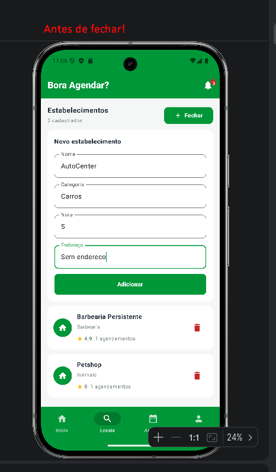
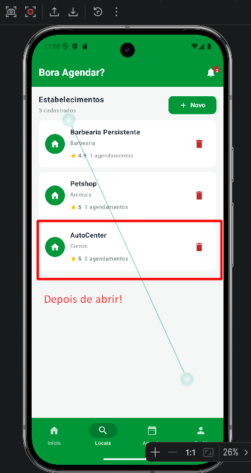
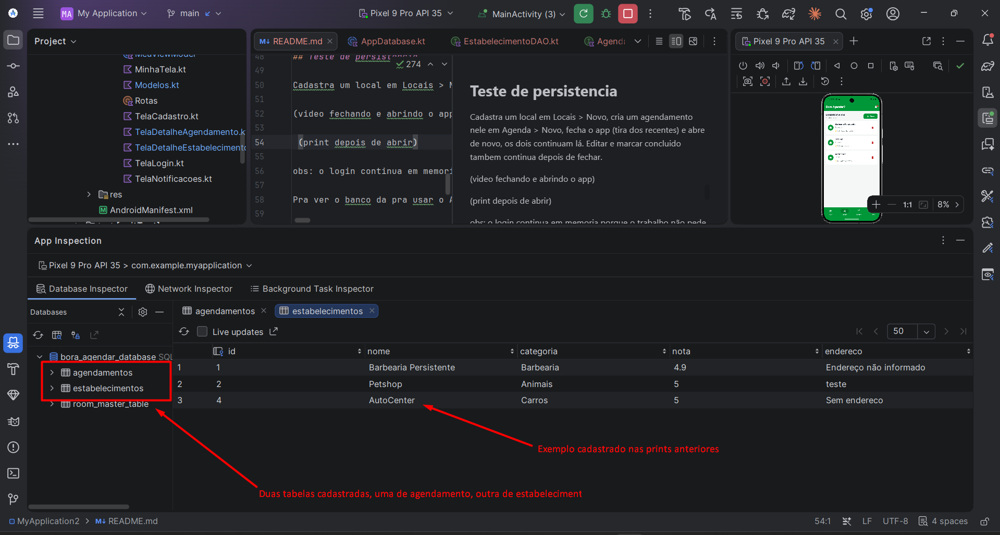

# Bora Agendar - Trabalho 3

Gabriel Valenga Silva e Rafael Moura

Continuação do trabalho 2, o app é o mesmo mas agora salva no banco com Room

## Como rodar

Abre no Android Studio, da sync no gradle e roda no emulador. Se der erro de versão do Java tem que trocar o Gradle JDK pro 17 ou 21 em File > Settings > Build Tools > Gradle (falamos disso mais embaixo). No app cria uma conta no cadastre-se, entra e usa as abas Locais e Agenda.

## Como tava antes e o que mudou

No trabalho 2 as listas ficavam no MeuViewModel com mutableStateListOf e ja tinha uns estabelecimentos e agendamentos fixos. Adicionar e remover funcionava mas fechou o app perdeu tudo, e os ids a gente gerava na mão com um contador.

Agora colocamos o Room no gradle (room-runtime, room-ktx e o room-compiler com ksp), transformamos Estabelecimento e Agendamento em Entity e criamos os DAOs e o AppDatabase. As listas continuam no ViewModel mas quem enche elas é o buscarTodos do banco, e as telas chamam isso num LaunchedEffect(Unit) quando abrem. Inserir, editar e apagar é tudo com CoroutineScope(Dispatchers.IO).launch e try/catch com Log.e igual o exemplo dos filmes da aula. Tiramos os dados fixos entao o app começa vazio, e os contadores de id tambem porque o banco gera sozinho.

## Entity, DAO e Database

Entities ficaram no Modelos.kt:
- Estabelecimento: id, nome, categoria, nota, endereco
- Agendamento: id, idEstabelecimento, servico, data, hora, preco, observacao, concluido

Usamos os mesmos campos que ja tinha no trabalho 2 porque as telas ja usavam eles, o idEstabelecimento é pra saber de qual local é o agendamento e o concluido é o checkbox. So mudou o id que agora é @PrimaryKey(autoGenerate = true) com valor 0.
A notificação deixamos em memoria, o trabalho pede 2 entity.

Os 2 DAOs (EstabelecimentoDAO e AgendamentoDAO) tem inserir, buscarTodos, atualizar e deletar, tudo suspend. O AppDatabase é igual o da aula com companion object, @Volatile e synchronized.

## Queries

Fora as 4 basicas colocamos buscarPorId nos dois DAOs, que é usado nas telas de detalhe. Antes o detalhe procurava o item na lista, agora pega o id que vem da navegação e busca no banco.

No AgendamentoDAO tem tambem o buscarPorEstabelecimento pra mostrar os agendamentos e o total gasto no detalhe do estabelecimento, e o deletarPorEstabelecimento pra quando apagar um local apagar os agendamentos dele junto (no trabalho 2 ja fazia isso na lista).

O atualizar é usado no salvar alterações do agendamento, no marcar como concluido e no editar estabelecimento (na tela de detalhe do local).

## O que deu problema

Comecei a fazer em outro pc e o projeto nem rodava, dava "Incompatible Gradle JVM version". O Android Studio de lá veio com o java 25 e o gradle 8.10.2 do projeto so aceita ate o 23. Tinha o JDK 21 instalado entao foi so apontar o gradle pra ele.

O exemplo da aula usa androidx.room3 e a gente usou o room normal (2.7.2) entao os imports são androidx.room. Tambem tem que colocar o plugin do ksp e dar sync antes de colocar o ksp do room-compiler senão da erro.

As funções de adicionar e atualizar retornavam true/false na hora, com o banco a gravação vai pra outra thread entao deixamos so a validação dos campos na hora e o resto no Dispatchers.IO, depois de salvar busca a lista de novo. Pra mexer na lista depois de buscar tem que voltar pro Dispatchers.Main.

A tela de detalhe começou a abrir com "Agendamento não encontrado" e os campos vazios, porque o item ainda não tinha vindo do banco. Colocamos um carregando e so preenche os campos depois que chega. E depois de salvar ela continuava mostrando o valor antigo, ai colocamos uma variavel recarregar no LaunchedEffect pra buscar de novo.

## Teste de persistencia

Cadastra um local em Locais > Novo, cria um agendamento nele em Agenda > Novo, fecha o app (tira dos recentes) e abre de novo, os dois continuam lá. Editar e marcar concluido tambem continua depois de fechar.

Video do teste: https://drive.google.com/file/d/1gBoJ37ZdDdNDIq6m91Wk2id3Ozyj_KrL/view?usp=drive_link

Antes de fechar, cadastrando o AutoCenter (ja tinha a Barbearia Persistente e o Petshop):

Depois de fechar e abrir de novo o AutoCenter continua lá, 3 cadastrados:

obs: o login continua em memoria porque o trabalho não pede, entao depois de fechar tem que cadastrar a conta de novo pra entrar, mas os dados do banco continuam.

Pra ver o banco da pra usar o App Inspection > Database Inspector do Android Studio com o app rodando. Da pra ver as duas tabelas (agendamentos e estabelecimentos) e os mesmos dados das prints de cima. O id 3 não aparece porque esse a gente apagou no app, entao o deletar tambem ta funcionando no banco.

## Dificuldades

- o erro do java quando troquei de pc, demorou pra entender que não era o codigo
- ficamos na duvida se precisava buscar por id e se era em todas as telas ou so em uma, no enunciado é pelo menos uma tela de detalhe, fizemos nas duas
- não sabia como ver se tava salvando mesmo, achamos o Database Inspector do Android Studio que mostra as tabelas
